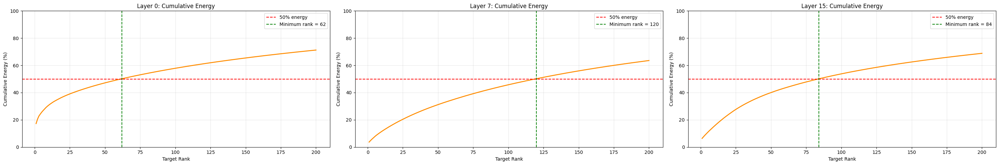

# Which Singular Directions Matter? A Spectral Study of SVD-Initialized LoRA for LLM Fine-Tuning

**PiSSA** (Meng et al., NeurIPS 2024) improves on LoRA by initializing the low-rank adapter from
the **top-r singular components** of each pretrained weight matrix instead of from noise and zeros.
This project tests the assumption behind that choice:

> *Is it the principal subspace specifically that makes SVD-based initialization work, or would
> any slice of the singular-value spectrum do?*

Building on the official PiSSA method, I wrote a PyTorch implementation and generalized it so the adapter can be
initialized from **any window of the spectrum** (top, 25th percentile, median, or bottom). I then
fine-tuned **Llama-3.2-1B** on mathematical reasoning (MetaMathQA) and evaluated it on **GSM8K**
and **MATH**, varying rank and spectral position independently. A separate analysis of the
singular-value spectra of Llama's attention weights shows how much "energy" a rank-r adapter can
actually capture in each layer.

---

## Highlights

- **Custom PiSSA adapter.** A `PiSSALinear` layer holds a frozen residual
  weight and trainable low-rank factors, injected into all 7 projection types (`q, k, v, o, gate,
  up, down`) across all 16 decoder layers (112 layers).
- **Spectral-window initialization.** One `component` switch picks which singular values form the
  adapter: `default` (top-r), `quarter`, `half` or `bottom`.
- **Exact reconstruction.** Before training, the decomposition W = W_res + AB is checked to
  within **2 × 10⁻⁴** maximum relative error, so the model's starting behavior is unchanged.
- **Rigorous evaluation pipeline.** Response-only loss masking, batched generation, an answer
  parser that handles several output formats (`The answer is:`, `####`, `\boxed{}`), and
  LaTeX-aware normalization for MATH with a numeric-equivalence fallback (e.g. `0.5 ≡ 1/2`).
- **Runs on modest hardware.** FP16 with FP32 adapter math, gradient accumulation to an effective
  batch of 128, and `DataParallel` across 2× T4 GPUs on Kaggle.

## Method

For each target weight matrix W ∈ ℝ^(m×n), take its SVD W = U S Vᵀ and select a window of r
singular triplets starting at index `s`:

```text
A     = U[:, s:s+r] · √S[s:s+r]           (m × r, trainable)
B     = √S[s:s+r] · Vᵀ[s:s+r, :]          (r × n, trainable)
W_res = W − A·B                            (frozen)

forward(x) = x·W_resᵀ + (x·Bᵀ)·Aᵀ
```

After training, the adapter is merged back into the weights (`W_final = W_res + AB`), so inference
costs nothing extra.

| `component` | Window start `s` | Interpretation |
| --- | --- | --- |
| `default` | 0 | Principal directions (original PiSSA) |
| `quarter` | ⌊k/4⌋ | Upper-middle of the spectrum |
| `half` | ⌊k/2⌋ | Middle of the spectrum |
| `bottom` | k − r | Smallest singular values (MiLoRA-style) |

### Experimental Setup

| | |
| --- | --- |
| Base model | `meta-llama/Llama-3.2-1B` |
| Training data | MetaMathQA, first 25k examples, 1 epoch |
| Evaluation | GSM8K and MATH (PiSSA test split), 1,000 examples each, accuracy |
| Optimizer | AdamW, lr 2e-5, 3% linear warmup → cosine decay |
| Batch | 8 per step × 16 accumulation = 128 effective |
| Sequence length | 512 tokens; loss on response tokens only |
| Experiment grid | Rank sweep {16, 64, 256} with `default`; position sweep {`default`, `quarter`, `half`, `bottom`} at r = 16; plus a no-fine-tuning baseline |
| Seed | 42 |

## Results

### Fine-tuning

| Initialization | Rank | Trainable params | GSM8K | MATH |
| --- | ---: | ---: | ---: | ---: |
| `bottom` | 16 | 11.3M (0.9%) | 11.6% | 2.6% |
<!-- TODO: add baseline, default r16/r64/r256, quarter r16, half r16 rows -->

<sub>The r = 16 bottom-spectrum run took 72 min of training on 2× T4 and reached a final training
loss of 0.506.</sub>

### Spectral analysis of attention weights

How many singular values does a layer need to keep **50% of the spectral energy**
(Σσᵢ² / Σσ²) of its `q_proj` weight?

| Layer | Rank for 50% energy (of 2,048) |
| --- | ---: |
| 0 (first) | 62 |
| 7 (middle) | 120 |
| 15 (last) | 84 |



**Takeaways.**

- The spectra are **heavy-tailed but not low-rank.** Even the most concentrated layer needs
  62 directions to reach half of its energy, so a rank-16 adapter covers only a small part of
  each matrix.
- Energy concentration **varies with depth.** The first layer is the most concentrated, and the
  middle layers are the most spread out. This suggests that a single global rank is not ideal
  for every layer, which motivates adaptive-rank methods such as AdaLoRA.
- Initializing from the bottom of the spectrum puts the adapter on directions with almost no
  energy (σ ≈ 10⁻⁵ to 10⁻³ in some attention layers). That shows how differently the windows
  start out before any training.

## Repository Structure

```text
finetune_q1-q3.ipynb   PiSSA implementation, spectral-window initialization, training,
                       merge, and GSM8K / MATH evaluation
finetune_q4.ipynb      Singular-value and cumulative-energy analysis of Llama-3.2-1B
figures/               Spectrum and energy plots per layer
```

## Running the Experiments

The notebooks are designed for **Kaggle** (GPU: T4 ×2 or any single CUDA GPU).

1. Request access to [`meta-llama/Llama-3.2-1B`](https://huggingface.co/meta-llama/Llama-3.2-1B)
   and add your Hugging Face token as a Kaggle secret named `HF_TOKEN`.
2. In `finetune_q1-q3.ipynb`, edit the experiment grid:

   ```python
   MANUAL_RUNS = [
       {'rank': 16, 'component': 'default'},
       {'rank': 16, 'component': 'bottom'},
   ]
   RUN_FRESH_BASELINE = True   # also evaluate the un-tuned model
   ```

3. Run all cells. Each run writes a JSON summary, and all runs are collected in
   `/kaggle/working/Assignment1/benchmark_results.csv`.
4. `finetune_q4.ipynb` is independent and only needs the model weights.

## Tech Stack

Python · PyTorch · Hugging Face Transformers & Datasets · NumPy · Pandas · Matplotlib · Kaggle (2× T4)

## Acknowledgements

This project began as an assignment for a graduate Big Data / LLM course. The adapter design,
prompt template and MATH answer normalization follow the official
[PiSSA implementation](https://github.com/MuLabPKU/PiSSA). The spectral-window generalization,
training and evaluation pipeline, and spectrum analysis are my own.

## References

1. Meng, F., Wang, Z., & Zhang, M. (2024). *PiSSA: Principal Singular Values and Singular Vectors
   Adaptation of Large Language Models.* NeurIPS 2024. [arXiv:2404.02948](https://arxiv.org/abs/2404.02948)
2. Hu, E. et al. (2022). *LoRA: Low-Rank Adaptation of Large Language Models.* ICLR 2022.
3. Wang, H. et al. (2024). *MiLoRA: Harnessing Minor Singular Components for Parameter-Efficient
   LLM Finetuning.* arXiv:2406.09044.
4. Yu, L. et al. (2024). *MetaMath: Bootstrap Your Own Mathematical Questions for Large Language
   Models.* ICLR 2024.
